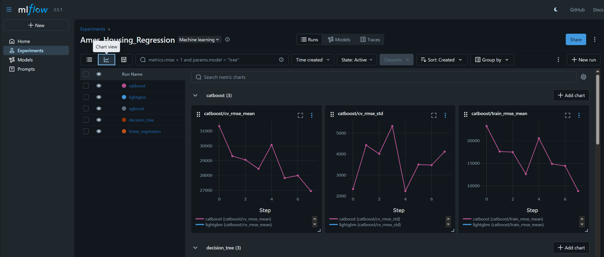

# Introduction to ML Crash Course

## Environment Setup

The project uses Python 3.14 and [uv](https://docs.astral.sh/uv/). Dependencies are declared in `pyproject.toml` and locked in `uv.lock`.

### Install uv

On Linux or macOS, run in a terminal:

```sh
curl -LsSf https://astral.sh/uv/install.sh | sh
```

On Windows, run in PowerShell:

```powershell
powershell -ExecutionPolicy ByPass -c "irm https://astral.sh/uv/install.ps1 | iex"
```

Restart your terminal if needed, then verify the installation with `uv --version`. See the [official installation guide](https://docs.astral.sh/uv/getting-started/installation/) for alternative installation methods.

### Set up the project

From the repository root, run:

```sh
uv sync --python 3.14
```

`uv sync` creates `.venv` and installs the locked dependencies. If Python 3.14 is not available locally, uv can download it. Optionally activate the environment:

Linux and macOS (bash/zsh):

```sh
source .venv/bin/activate
```

Windows (PowerShell):

```powershell
.\.venv\Scripts\Activate.ps1
```

To launch JupyterLab without activating the environment, run `uv run jupyter lab`.

## Running MLflow Server

From the repository root, start the MLflow UI using the uv environment:

```powershell
uv run mlflow ui --backend-store-uri sqlite:///mlflow.db --host 127.0.0.1
```

The existing `mlflow_server_start.bat` instead activates the Conda environment; it does not use `.venv`.

## Accessing MLflow UI

Once the server is running, open your browser and navigate to:

```
http://127.0.0.1:5000
```

You'll see:
- **Experiments:** List of all tracked experiments
- **Runs:** Individual model training runs with hyperparameters and metrics
- **Line Charts:** Visualization of HPO iterations showing how metrics improve across parameter combinations
- **Leaderboard:** Model comparison sorted by performance metrics



*MLflow UI showing experiments, metrics, and model comparison*

See [Running Experiments](exercises/README.md#running-experiments) for the exercise workflow.

## Attribution

The [`Interactive Decision Tree`](Interactive%20Decision%20Tree/) folder contains third-party material from Avi Chawla's [“Interactively Prune a Decision Tree”](https://blog.dailydoseofds.com/p/interactively-prune-a-decision-tree) (Daily Dose of Data Science, April 7, 2024). See the folder's [attribution](Interactive%20Decision%20Tree/ATTRIBUTION.md) for details.
