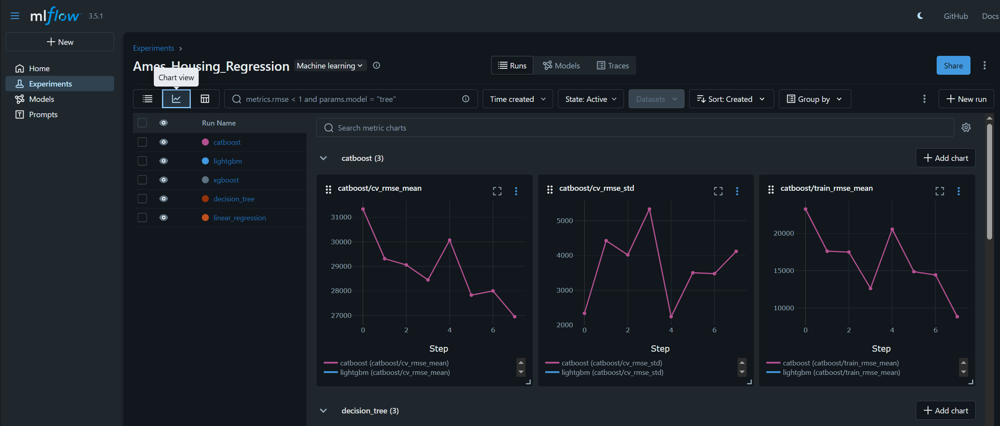

# Exercises

This folder contains the hands-on notebooks for the machine learning course:

1. `01_classification.ipynb` — Classification and credit risk.
2. `02_regression_and_hyperparameter_optimization.ipynb` — Regression and hyperparameter optimization.
3. `03_time_series_forecasting.ipynb` — Time series forecasting.

Before running the notebooks, set up the project's uv environment as described in the [project README](../README.md#environment-setup). Then open them in Jupyter and run them in order.

## Running MLflow Server

From the same working directory used by the regression notebook, start the MLflow UI using the uv environment. Both the notebook and server use `sqlite:///mlflow.db`, which refers to a database in the current working directory:

```powershell
uv run mlflow ui --backend-store-uri sqlite:///mlflow.db --host 127.0.0.1
```

The existing `mlflow_server_start.bat` instead activates the Conda environment; it does not use `.venv`.

## Accessing MLflow UI

Once the server is running, open your browser and navigate to:

```
http://127.0.0.1:5000
```

You'll see:
- **Experiments:** List of all tracked experiments
- **Runs:** Individual model training runs with hyperparameters and metrics
- **Line Charts:** Visualization of HPO iterations showing how metrics improve across parameter combinations
- **Leaderboard:** Model comparison sorted by performance metrics



*MLflow UI showing experiments, metrics, and model comparison*

## Running Experiments

### Step 1: Prepare Data and Models

In `02_regression_and_hyperparameter_optimization.ipynb`, run the cells through the HPO Engine section to:
- Load the Ames Housing dataset
- Preprocess data with appropriate encoders
- Define the pipeline factory
- Setup MLflow experiment tracking

### Step 2: Run Hyperparameter Optimization

Run the Execution Loop section to:
- Setup MLflow experiment (handles deleted experiments automatically)
- Run grid search for each model:
  - Linear Regression
  - Decision Tree
  - XGBoost
  - LightGBM
  - CatBoost
- Log all HPO iterations with model-specific metric names
- Display a leaderboard of results

### Step 3: View Results in MLflow UI

The metrics are logged with model-namespaced names:
- `xgboost/cv_rmse_mean`
- `lightgbm/cv_rmse_mean`
- `decision_tree/cv_rmse_mean`
- etc.

Each model gets a **consistent color** across all visualizations for easy comparison.

## Understanding the Output

### Line Charts

Each model's line chart shows:
- **X-axis:** HPO iteration steps (0 to N)
- **Y-axis:** Metric values (CV RMSE, Training RMSE, etc.)
- **Color:** Consistent per model name
- **Dots:** Each HPO iteration

### Final Leaderboard

After all experiments complete, you'll see:
- **Model:** Name of the model
- **Test RMSE:** Error on held-out test set
- **Test R²:** R-squared score on test set
- **Best Params:** Optimal hyperparameters found by grid search

## Troubleshooting

### Issue: "Cannot set a deleted experiment"

If you manually deleted an experiment in MLflow:
1. The code automatically detects this
2. It either restores the experiment or creates a new one with a timestamp suffix
3. No manual intervention needed - just re-run the cells

### Issue: "ModuleNotFoundError: No module named 'mlflow'"

Ensure the environment is properly activated:
```powershell
.\.venv\Scripts\Activate.ps1
python -c "import mlflow; print(mlflow.__version__)"
```

### Issue: Port 5000 Already in Use

If port 5000 is busy, specify a different port:
```powershell
uv run mlflow ui --backend-store-uri sqlite:///mlflow.db --port 5001
```

Then access at `http://127.0.0.1:5001`
