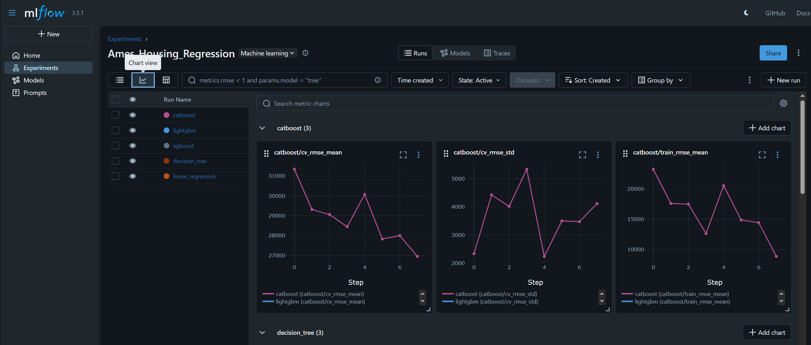

# Exercises

This folder contains the hands-on notebooks for the machine learning course:

1. `01_classification.ipynb` — Classification and credit risk.
2. `02_regression_and_hyperparameter_optimization.ipynb` — Regression and hyperparameter optimization.
3. `03_time_series_forecasting.ipynb` — Time series forecasting.

Before running the notebooks, set up the project's uv environment as described in the [project README](../README.md#environment-setup). Then open them in Jupyter and run them in order.

## Running MLflow Server

From the same working directory used by the regression notebook, start the MLflow UI using the uv environment. Both the notebook and server use `sqlite:///mlflow.db`, which refers to a database in the current working directory:

```powershell
uv run mlflow ui --backend-store-uri sqlite:///mlflow.db --host 127.0.0.1
```

The existing `mlflow_server_start.bat` instead activates the Conda environment; it does not use `.venv`.

## Accessing MLflow UI

Once the server is running, open your browser and navigate to:

```
http://127.0.0.1:5000
```

You'll see:
- **Experiments:** List of all tracked experiments
- **Runs:** Baseline and HPO selection scores by model, the nested cross-validation comparison for XGBoost, and the final test score



*MLflow UI showing experiments, metrics, and model comparison*


## Troubleshooting


### Issue: "ModuleNotFoundError: No module named 'mlflow'"

Ensure the environment is properly activated:
```powershell
.\.venv\Scripts\Activate.ps1
python -c "import mlflow; print(mlflow.__version__)"
```

### Issue: Port 5000 Already in Use

If port 5000 is busy, specify a different port:
```powershell
uv run mlflow ui --backend-store-uri sqlite:///mlflow.db --port 5001
```

Then access at `http://127.0.0.1:5001`
